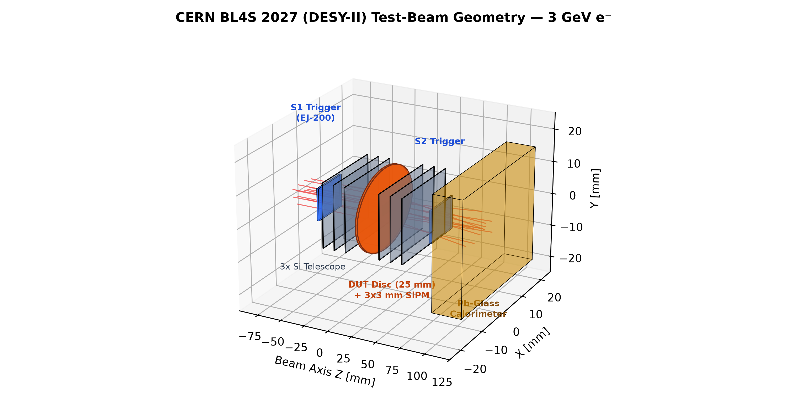
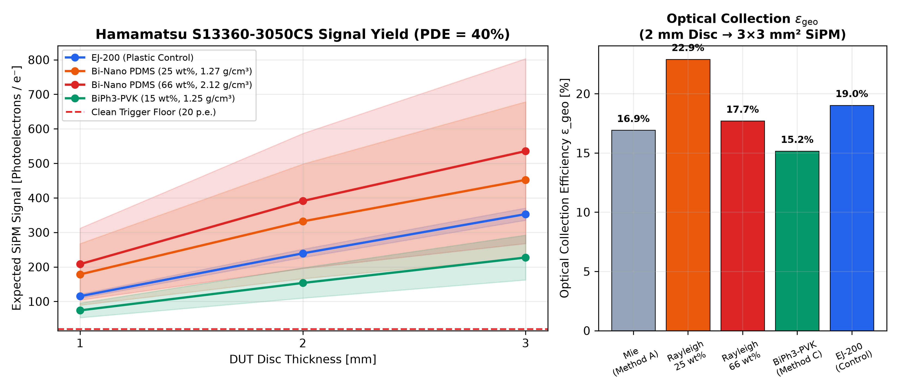

# PEBBLE: Lead-Free Bismuth Scintillators for CERN BL4S 2027

PEBBLE (**P**erovskite **E**lectron **B**eam **B**enchmark for **L**ight **E**mission) is a student entry for the [CERN Beamline for Schools](https://beamline-for-schools.web.cern.ch/) competition. It asks one question: on a GeV electron beam, can a lead-free bismuth-loaded plastic scintillator beat commercial EJ-200 in a detector only a few millimetres thick?

This repository contains the simulation behind that question: a Geant4 model of energy deposition and a ray-traced model of light collection, both driven from one config file.

## The question

A 2 mm EJ-200 disc sits at 0.47% of a radiation length. It is fast and cheap, but thin and light, so a 3 GeV electron deposits only about 0.3 MeV in it.

Loading the polymer with bismuth changes that. The composite gets denser and its radiation length shortens, so each millimetre absorbs more energy and produces more bremsstrahlung and scattering. The optics get worse as the loading rises: the material becomes hazier, less light reaches the SiPM, and the molecular BiPh3-PVK route starts from a lower light yield.

The question is therefore not whether bismuth is "better", but where the product of deposited energy and collected light peaks, and whether any of these materials clears the photoelectron threshold for a clean trigger.

## The setup



| Component | Description |
| --- | --- |
| Beam | DESY-II single electrons, 1–6 GeV/c, uniform 20 mm spot with 0.15 GeV energy spread; ELSA (0.8–3.2 GeV) as the alternative |
| Trigger | Two 10 × 10 × 2 mm EJ-200 paddles at z = ∓60 mm, coincidence on > 0.05 MeV in each |
| Sample | 25 mm disc, 1–3 mm thick (2 mm nominal), wrapped in 3M ESR foil (R = 98.5%) |
| Readout | Hamamatsu S13360-3050CS SiPM, 3 × 3 mm², 40% PDE at 450 nm, coupled with n = 1.465 grease |
| Threshold | 20 photoelectrons for a clean trigger |

With a 20 mm beam spot and 10 mm paddles, the coincidence accepts about 31% of the electrons.

## What the simulation does

**Energy deposition (Geant4).** A single-file C++ application on `FTFP_BERT` with `G4EmStandardPhysics_option4` steps each electron through the paddles and the disc and records the energy deposited in each. The lead-glass calorimeter is represented only by the kinetic energy entering its front face: developing an 18.5 cm electromagnetic shower there dominated the runtime and adds nothing to the comparison, so the track is stopped at the face.

**Light collection (NumPy ray tracer).** Scintillation photons are traced from their production point to the SiPM through Fresnel and total-internal reflection at the disc faces, absorption and isotropic scattering in the bulk, specular reflection off the ESR wrap, and transmission through the grease and epoxy layers. A 100,000-photon sample takes about a second per disc, which is why the optics run outside Geant4.

**Checks against theory.** Energy-loss spectra are fitted with a Moyal distribution, whose location parameter estimates the Landau most-probable value. The simulated multiple-scattering angle is compared with the PDG Highland formula and plotted against it in the scattering figure.

## Results

3 GeV electrons on a 2 mm disc, 25,000 events per configuration:

| Material | Density (g/cm³) | X₀ (mm) | ΔE MPV (MeV) | Light collection | SiPM yield (p.e.) |
| --- | ---: | ---: | ---: | ---: | ---: |
| EJ-200 (control) | 1.03 | 425 | 0.315 | 19.0% | 239 |
| Bi-nano PDMS, 25 wt% | 1.27 | 151 | 0.362 | 22.9% | 332 |
| Bi-nano PDMS, 66 wt% | 2.12 | 56 | 0.552 | 17.7% | 391 |
| BiPh3-PVK, 15 wt% | 1.25 | 245 | 0.362 | 15.2% | 154 |



The 66 wt% disc deposits 1.75× the energy of EJ-200 and returns the highest yield at 391 p.e., but its collection efficiency is the second worst of the four. The gain comes from density and radiation length, not from better optics.

At 25 wt%, the loading the team expects to reach by wet casting, the disc returns 39% more photoelectrons than EJ-200 and has the best collection efficiency in the set.

BiPh3-PVK matches the 25 wt% disc in deposited energy but returns only 154 p.e., below the 239 of EJ-200, because its light yield per MeV is lower and its higher refractive index traps more light. All four materials still clear the 20 p.e. threshold, so the choice is about margin.

A separate optical run with a 0.4 mm scattering length, standing in for hazy microcrystals, collects 16.9% of the light against 22.9% for the clear nanocrystal disc, a 1.4× difference between the two synthesis routes.

## Running it

```bash
conda env create -f environment.yml
conda activate bl4s-sim

python run_pipeline.py --smoke-test    # 2,000 events, about 30 s
python run_pipeline.py                 # full statistics, about 2–3 min
python run_pipeline.py --skip-geant4   # re-plot from existing CSVs, about 3 s
```

`environment.yml` pins the headless `geant4=*=noqt*` build, so `--vis` reports that no viewer is available; a Qt build plus `-DBL4S_VIS=ON` enables it. The `expat` and `zlib` entries are there because Geant4's CMake config requires versions newer than the ones the macOS SDK ships.

## Repository layout

| Path | Contents |
| --- | --- |
| `config.json` | Beam, geometry, material and optical parameters; the only file you need to edit for a sweep |
| `src/sim.cc` | Geant4 application: geometry, stepping action, CSV output |
| `src/optical_mc.py` | Vectorised photon transport and collection efficiency |
| `run_pipeline.py` | Builds the simulation, runs the sweep in parallel, fits, cross-checks and plots |
| `results/` | Figures, per-job metrics and the summary table |

## Scope and limits

The numbers come from a simulation, not a measurement. They show whether the experiment is worth proposing and what detector size it needs.

Material parameters are literature values or estimates. Light yields are ranges, and the figures show those ranges as bands. Absorption and scattering lengths are nominal, scattering is isotropic rather than angularly resolved, and the optical model works at the single design wavelength of 450 nm. Electronics, timing resolution and calibration are not simulated.

The simulated scattering angle agrees with the Highland formula to within 4% at the three lower loadings and to within about 10% at 66 wt%.

Two of the three bismuth formulations return more photoelectrons than EJ-200. The 25 wt% disc also has the best collection efficiency of the set, while the 66 wt% disc returns the most photoelectrons but collects light least efficiently.

## License

All rights reserved. The code, figures and results in this repository may not be copied, reused or redistributed without written permission. See [LICENSE](LICENSE).
